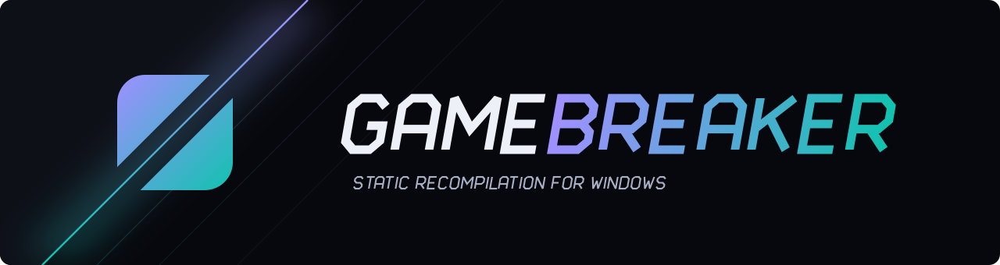
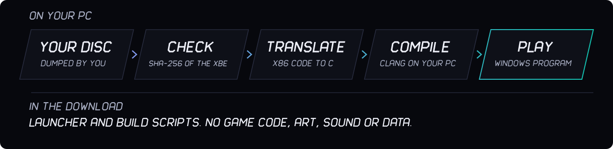
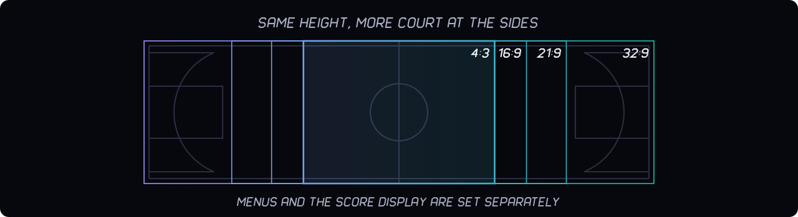

<p align="center">
  <picture>
    <source media="(prefers-color-scheme: dark)" srcset="docs/art/banner-dark.svg">
    <source media="(prefers-color-scheme: light)" srcset="docs/art/banner-light.svg">
    
  </picture>
</p>

Gamebreaker is a native Windows port of *NBA Street Vol. 2*, from the 2003 Xbox
release. It is a static recompilation: setup translates the game's code and
compiles it on your PC, from your own disc.

**The download contains no part of the game.** You need your own copy of the USA
Xbox release.

<p align="center">
  <a href="https://github.com/GamebreakerDev/Gamebreaker/releases/download/v0.1.2/Gamebreaker-0.1.2.zip"></a>
</p>

<p align="center">
  <a href="#install">Install</a>&emsp;
  <a href="#features">Features</a>&emsp;
  <a href="#status">Status</a>&emsp;
  <a href="#questions">Questions</a>&emsp;
  <a href="docs/KNOWN-ISSUES.md">Known issues</a>
</p>


## Install

You need 64-bit Windows 10 (version 1809 or later) or Windows 11, a Direct3D 11
graphics card, 3.5 GB of free disk space, an internet connection for setup, and a
dump of your own disc as an `.iso` or an extracted folder.

1. Download the latest release, extract it and start `Gamebreaker.exe`.
2. Choose an install folder and your disc image.
3. Press Download for the build tools and wait 3 to 10 minutes for the build.
4. Press Play.

The programs are unsigned, so Windows may ask you to confirm the first start. On
Windows 10 the launcher also needs Microsoft's Edge WebView2 Runtime.

<picture>
  <source media="(prefers-color-scheme: dark)" srcset="docs/art/pipeline-dark.svg">
  <source media="(prefers-color-scheme: light)" srcset="docs/art/pipeline-light.svg">
  
</picture>

## Features

Every game mode and all eleven courts are here, at the game's original speed.

<p align="center">
  
  
</p>

Play in a window or borderless fullscreen, at up to four times the original
resolution, with texture filtering and anti-aliasing. The 16:10, 16:9, 21:9 and
32:9 shapes show more of the court at the sides. 120 frames a second is available
as an experimental option.

<picture>
  <source media="(prefers-color-scheme: dark)" srcset="docs/art/shapes-dark.svg">
  <source media="(prefers-color-scheme: light)" srcset="docs/art/shapes-light.svg">
  
</picture>


Xbox-type controllers work with rumble, and every keyboard key can be changed;
keys go by their place, so the defaults sit in the same spots on any layout.
Music, effects, crowd, voices and commentary have separate volumes. The game's
twelve cheats are switches in the launcher, the last five versions of your save
are kept as backups, and F12 takes a screenshot.

Mods replace the game's files from a `mods` folder, managed on the launcher's Mods
page: [Using mods](docs/MODS.md) and [Making a mod](docs/MODDING.md).


<details>
<summary><b>Default keyboard controls</b></summary>
<br>

| Key | Does |
|---|---|
| W, A, S, D | Move |
| K | Pass, switch player (A) |
| L | Shoot (B) |
| J | Trick move, steal (X) |
| I | Second trick, block, rebound (Y) |
| Left Shift | 1 turbo (sprint, dunk) |
| Space | 2 turbos (Gamebreaker, turbo block, trick counter) |
| ; (semicolon) | All 3 turbos (advanced tricks and dunks, kick pass) |
| U | Strategy (right stick click) |
| Q, E | Pocket, cancel the Gamebreaker (White, Black) |
| T, F, G, H | Right stick (Give 'n Go) |
| Arrow keys | D-pad (menus) |
| Enter | START (pause) |
| Esc, Backspace | BACK |

Keys go by their place: on a French or German keyboard the same keys do the
same things, whatever is printed on them. Every key can be changed in the
launcher, Settings, Keyboard.

</details>

## Status

This is an early release. Every mode starts and plays, though a whole Be A Legend
or Street School run has not been finished yet. Four controllers at once and 120
frames a second are experimental, and Windows 10 and AMD graphics are untested.
Rarely, the game can stop responding while the picture carries on; restarting it
clears this.

The [known issues](docs/KNOWN-ISSUES.md) have the details. To report a problem,
[open an issue](https://github.com/GamebreakerDev/Gamebreaker/issues) and attach
`logs\game.log`.

## Questions

<details>
<summary><b>Is this a decompilation?</b></summary>
<br>

No. A recompiler translates the original program automatically. The result comes
from the game's code, so it is generated on your PC and never published.

</details>

<details>
<summary><b>Which disc do I need?</b></summary>
<br>

The USA Xbox release. Setup checks that `default.xbe` has this SHA-256:

```
08389AE31309FACD89EC7A1057CEC32C4308D734D0B8AD9151437AA511CBDCFE
```

Please do not ask where to get disc images.

</details>

<details>
<summary><b>Can I use a PlayStation or Switch controller?</b></summary>
<br>

Only through a layer that presents it as an Xbox controller, such as Steam Input.

</details>

<details>
<summary><b>Does it run on Linux or Steam Deck?</b></summary>
<br>

It is built for Windows. Wine and Proton are untested.

</details>

<details>
<summary><b>Where are my saves, and how do I uninstall?</b></summary>
<br>

Saves are in the install folder's `saves` folder. Nothing is installed into Windows,
so deleting the install folder and the extracted zip removes everything, saves
included. The default install folder is `%LOCALAPPDATA%\Gamebreaker`.

</details>

## Credits

Built on [xboxrecomp](https://github.com/sp00nznet/xboxrecomp) by sp00nznet and
contributors (MIT), whose sound and graphics chip models include parts of
[xemu](https://github.com/xemu-project/xemu) (LGPL-2.1-or-later). Licence texts are in
[THIRD-PARTY-NOTICES.md](THIRD-PARTY-NOTICES.md).

[Changelog](CHANGELOG.md)&emsp;[Building from source](docs/BUILDING.md)&emsp;[Contributing](CONTRIBUTING.md)

<a href="https://playported.com/ports/2133-nba-street-vol-2/"></a>
<a href="https://decompbuddy.com/games/nba-street-vol-2-gamebreaker-xbox"></a>

## Legal

Gamebreaker is an unofficial fan project, not affiliated with or endorsed by
Electronic Arts, EA Canada, the NBA, its teams or its players, or Microsoft.
*NBA Street* and all related names and marks belong to their owners. This repository
and its releases contain no game code, artwork, audio or data. Rights holders with
a concern can open an issue.

This repository's own code and documents are under the [MIT licence](LICENSE),
which grants no rights in the game, its program, data, names or marks. Some
files derive from the xboxrecomp toolkit and carry its notice as well; see
[THIRD-PARTY-NOTICES.md](THIRD-PARTY-NOTICES.md).

---

Built with AI assistance (Claude, by Anthropic) under human direction.
